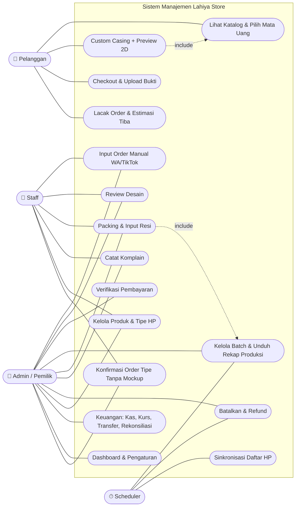
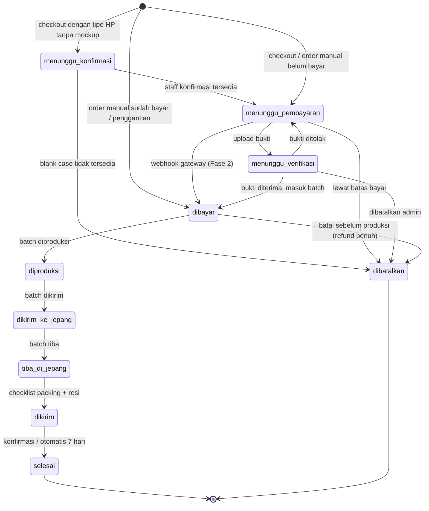
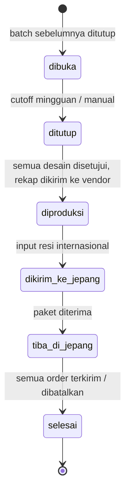
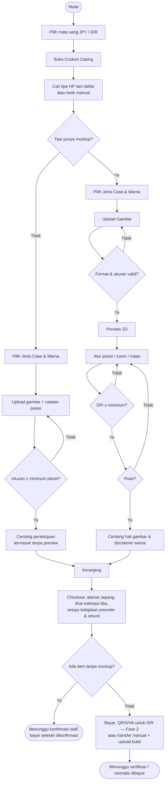
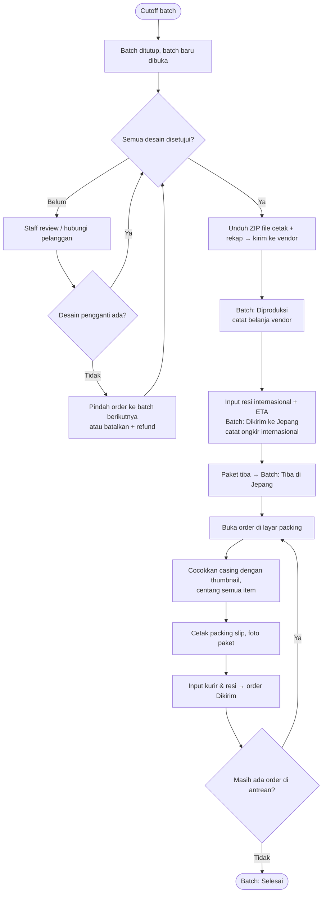
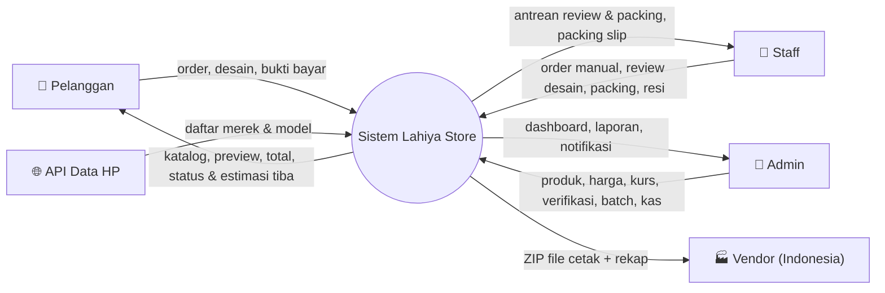
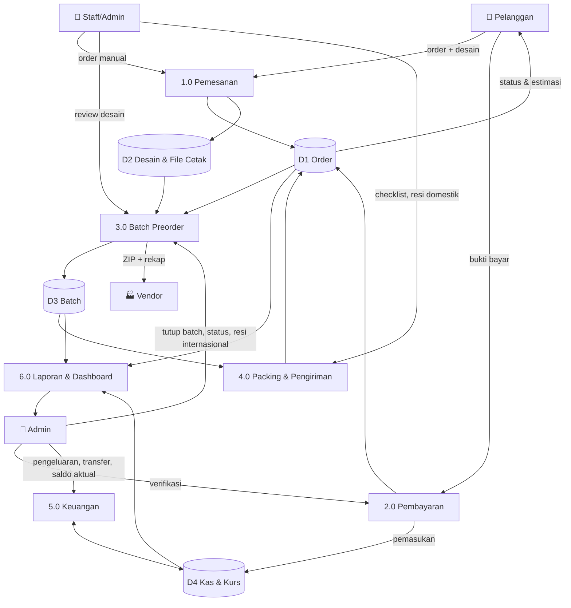
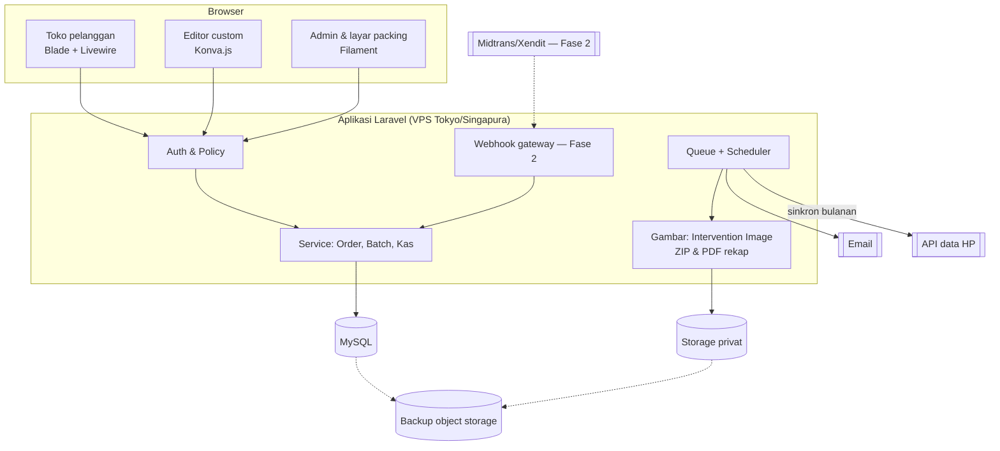

# Product Requirements Document (PRD)
# Sistem Manajemen Operasional "Lahiya Store"

| | |
|---|---|
| **Nama Produk** | Lahiya Store Management System |
| **Versi Dokumen** | 3.1 |
| **Tanggal** | Oktober 2026 |
| **Status** | Draft — sebagian besar keputusan sudah dikonfirmasi pemilik; sisa pertanyaan di §15 |
| **Pemilik Produk** | Lahiya Store (UMKM) |
| **Tim Pengembang** | Muhammad Daffa Alwafi (developer) dibantu Claude |
| **Tech Stack** | Laravel + MySQL + Filament + Livewire + Konva.js |

### Riwayat Revisi

| Versi | Perubahan Utama |
|---|---|
| 1.0 | Draft awal |
| 2.0 | Aturan bisnis, order manual, rekonsiliasi kas, skema database baru, Laravel |
| 3.0 | Menyesuaikan model bisnis yang sebenarnya: toko berbasis di Jepang, casing dibeli & dicetak di Indonesia lalu dikirim ke Jepang dengan sistem **preorder per batch**. Menambah modul batch preorder, dua mata uang (JPY & IDR) dengan kurs, transfer antar akun, alamat Jepang, gratis ongkir domestik, kebijakan pembatalan/retur/refund, spesifikasi file cetak, prosedur anti salah kirim, review desain sebelum produksi, request tipe HP, payment gateway (Fase 2). Sumber order: website, WhatsApp, TikTok. Peran staff naik ke Fase 1. Manajemen stok gudang dipindah ke Fase 2. Tabel ongkir per provinsi dihapus. |
| 3.1 | Daftar tipe HP diambil dari API data HP dan disinkronkan ke database sendiri, sehingga pelanggan bisa memilih tipe HP apa pun. Tipe tanpa mockup tetap bisa dipesan tanpa preview, dengan status baru `menunggu_konfirmasi` sebelum bayar. Pembeli mayoritas WNI yang bekerja di Jepang: Midtrans/Xendit untuk Rupiah (Fase 2), Yen tetap transfer manual, gateway Yen dipindah ke Fase 3. Tabel `phone_model_requests` dihapus. |

---

## 1. Latar Belakang

### 1.1 Model Bisnis

- Lahiya Store **berbasis di Jepang** dan menjual casing HP custom sebagai produk utama, serta produk lain (elektronik, baju, sepatu, celana, jaket).
- Casing **dibeli dan dicetak di Indonesia** oleh vendor, lalu dikirim ke Jepang. Karena itu semua penjualan memakai sistem **preorder**: order dikumpulkan, dipesan ke vendor per batch, dikirim ke Jepang, lalu dikemas dan dikirim ke pelanggan.
- Pembeli mayoritas **WNI yang bekerja di Jepang**.
- Pelanggan memesan lewat **WhatsApp dan TikTok**. Tidak ada penjualan tatap muka dan tidak ada COD.
- Pelanggan membayar dalam **Yen (JPY) atau Rupiah (IDR)**. Rekening Rupiah: BCA.
- Pengiriman di Jepang **gratis ongkir**.
- Volume saat ini sekitar **50–100 casing per minggu**, dikelola pemilik dan **2–3 staff**.

### 1.2 Masalah Saat Ini

1. **Pemesanan via WhatsApp/TikTok** — Detail pesanan (tipe HP, desain, alamat) tercecer di antara chat.
2. **Pencatatan order di buku manual** — Order dicoret saat dikirim. Akibatnya ada order terlewat, **salah kirim 1–5 kali per minggu**, dan sulit melacak order di tahap mana.
3. **Pencatatan keuangan manual** — Uang masuk dalam dua mata uang dan keluar ke vendor di Indonesia, sehingga sering selisih (minus) dan tidak ada laporan laba/rugi.
4. **Order custom tidak terstandar** — Gambar dikirim via chat tanpa preview, sering terjadi salah paham hasil akhir.
5. **Status preorder tidak transparan** — Pelanggan tidak tahu pesanannya sedang diproduksi, di perjalanan ke Jepang, atau sudah dikirim.

### 1.3 Tujuan Sistem

- Mencatat **semua** order (website, WA, TikTok) di satu tempat, dari pemesanan sampai diterima.
- Mengelola preorder per batch: rekap produksi untuk vendor, pelacakan pengiriman ke Jepang, dan status yang terlihat pelanggan.
- Menyediakan katalog dan custom casing dengan preview 2D.
- Mencatat kas dua mata uang secara otomatis dan menyediakan rekonsiliasi untuk mendeteksi selisih.
- Menurunkan salah kirim lewat prosedur packing terstruktur.

---

## 2. Tujuan & Sasaran

| Tujuan | Indikator | Baseline | Target 3 bulan setelah rilis |
|---|---|---|---|
| Semua order tercatat | % order di sistem vs uang masuk di semua akun | Tidak terukur | 100% |
| Mengurangi salah kirim | Salah kirim per 100 casing | ±1–10 (1–5 kejadian dari 50–100 casing/minggu) | < 1 per 100 casing |
| Akurasi keuangan | Selisih rekonsiliasi yang tak terjelaskan per bulan | Sering minus | ≈ 0 |
| Standarisasi custom | Komplain hasil custom per 100 casing | Perlu dicatat 2–4 minggu | Turun ≥ 50% |
| Transparansi preorder | % pelanggan yang bisa melihat status & estimasi tiba sendiri | 0% | 100% |
| Efisiensi | Waktu menyiapkan rekap produksi untuk vendor per batch | Perlu dicatat | Turun ≥ 70% (rekap otomatis) |

---

## 3. Ruang Lingkup

### Dalam Ruang Lingkup (Fase 1)
- Katalog produk dengan harga JPY dan IDR.
- Custom casing dengan editor 2D, indikator kualitas cetak, dan review desain sebelum produksi.
- Daftar tipe HP lengkap dari API data HP; custom casing untuk tipe tanpa mockup (tanpa preview, dikonfirmasi staff).
- Order dari website dan input manual dari WhatsApp/TikTok.
- **Batch preorder**: pengumpulan order, rekap produksi + unduh file cetak, status pengiriman internasional.
- Packing terstruktur di Jepang dan input resi kurir domestik.
- Keuangan dua mata uang: akun kas, kurs, pemasukan otomatis, pengeluaran, transfer antar akun, refund, rekonsiliasi.
- Kebijakan pembatalan, retur, dan refund yang dijalankan sistem.
- Akun staff dan audit trail.

### Fase 2
- Payment gateway Rupiah: Midtrans atau Xendit (QRIS, virtual account, e-wallet).
- Laporan laba/rugi, laba per batch & produk, ekspor, grafik.
- Akun pelanggan, autofill alamat dari kode pos Jepang, laporan tipe HP tanpa mockup yang paling sering dipesan.
- Stok ready di Jepang (barang yang bisa dikirim tanpa menunggu batch).
- Notifikasi Telegram, tombol WA template, kurs otomatis.

### Fase 3 (opsional)
- Preview 3D casing.
- Payment gateway Yen (Stripe/KOMOJU), jika pembayar Yen cukup banyak.
- WhatsApp Business API.
- Tampilan bahasa Jepang.

### Di Luar Ruang Lingkup
- Aplikasi mobile native, multi-gudang.
- Sinkronisasi TikTok Shop / marketplace (order TikTok diinput manual).
- Pengiriman ke alamat di luar Jepang.
- Akuntansi lengkap (jurnal, neraca, pajak).

---

## 4. Pengguna & Peran

| Peran | Deskripsi |
|---|---|
| **Pelanggan tamu** | Checkout tanpa akun dengan nama, no. HP, dan alamat di Jepang |
| **Pelanggan terdaftar** (Fase 2) | Ditambah buku alamat dan riwayat order |
| **Admin (Pemilik)** | Akses penuh termasuk keuangan, modal, kurs, verifikasi pembayaran, dan batch |
| **Staff (2–3 orang)** | Input order manual, review desain, packing, input resi, kelola produk. Tidak melihat keuangan dan modal |

### Matriks Hak Akses

| Fungsi | Pelanggan | Staff | Admin |
|---|---|---|---|
| Katalog, custom casing, checkout, lacak order | ✔ | – | – |
| Kelola produk & varian (tanpa modal) | – | ✔ | ✔ |
| Kelola tipe HP, opsi custom, harga & modal | – | – | ✔ |
| Input order manual (WA/TikTok) | – | ✔ | ✔ |
| Review desain custom | – | ✔ | ✔ |
| Verifikasi pembayaran | – | – | ✔ |
| Kelola batch (tutup, ubah status, unduh rekap) | – | Lihat & unduh rekap | ✔ |
| Packing & input resi domestik | – | ✔ | ✔ |
| Catat komplain | – | ✔ | ✔ |
| Batalkan order berbayar & refund | – | – | ✔ |
| Keuangan, kurs, rekonsiliasi, laporan | – | – | ✔ |
| Akun staff & pengaturan | – | – | ✔ |

---

## 5. Persona

**Bu Lahiya (Pemilik, 38 th, tinggal di Jepang)**
Mengurus chat WA/TikTok, berkoordinasi dengan vendor di Indonesia, dan memegang uang di rekening Jepang dan BCA. Butuh: tahu batch minggu ini berisi apa, uang di tiap rekening berapa, dan laba sebenarnya setelah biaya vendor dan ongkir internasional.

**Sinta (Staff packing, di Jepang)**
Membuka kardus kiriman dari Indonesia berisi puluhan casing dan mengemasnya per pelanggan. Butuh: daftar jelas casing mana untuk siapa, supaya tidak salah kirim.

**Raka (Pelanggan, 24 th, pekerja Indonesia di Jepang)**
Mau casing iPhone 17 Pro Max dengan gambar anime buatannya. Punya rekening Indonesia dan rekening Jepang, jadi bisa bayar Rupiah (QRIS/m-banking) atau Yen. Butuh: preview, harga jelas, dan tahu kapan casingnya sampai.

**Dewi (Pelanggan, 29 th, pekerja Indonesia di Jepang)**
Memakai HP merek yang jarang ada casing custom-nya. Butuh: tetap bisa memilih tipe HP-nya dan memesan walaupun tanpa preview.

---

## 6. Aturan Bisnis

Bagian ini adalah acuan utama developer. Kalau ada perbedaan dengan bagian lain, bagian ini yang berlaku.

### 6.1 Batch Preorder

- Selalu ada **satu batch berstatus `dibuka`**. Setiap order yang pembayarannya diterima otomatis masuk ke batch yang sedang dibuka.
- Batch **ditutup setiap minggu** pada waktu cutoff (default Minggu 23:59 JST), atau ditutup manual oleh admin. Saat ditutup, batch baru langsung dibuka.
- Status batch dan efeknya ke order:

| Status batch | Arti | Status order di dalamnya |
|---|---|---|
| `dibuka` | Menerima order | `dibayar` |
| `ditutup` | Cutoff lewat; desain dicek, rekap disiapkan | `dibayar` |
| `diproduksi` | Rekap & file cetak sudah dikirim ke vendor di Indonesia | `diproduksi` |
| `dikirim_ke_jepang` | Vendor mengirim paket ke Jepang (resi internasional diinput) | `dikirim_ke_jepang` |
| `tiba_di_jepang` | Paket diterima di Jepang, siap dipacking | `tiba_di_jepang` |
| `selesai` | Semua order di batch sudah `dikirim`, `selesai`, atau `dibatalkan` | – |

- Batch tidak bisa dipindah ke `diproduksi` selama masih ada desain berstatus `menunggu` atau `revisi`.
- Pelanggan melihat **estimasi tiba** berdasarkan cutoff batch aktif (default 14–21 hari setelah cutoff), di halaman produk, checkout, dan lacak order.

### 6.2 Sumber Order

| Sumber | Dibuat oleh | Keterangan |
|---|---|---|
| `website` | Pelanggan | Checkout lewat website |
| `whatsapp` | Admin/Staff | Order dari chat WA diinput manual |
| `tiktok` | Admin/Staff | Order dari DM/komentar TikTok diinput manual |
| `penggantian` | Admin | Order pengganti (cetak ulang) dari komplain, total 0, terhubung ke order asal |

### 6.3 Status Order

| Status | Arti | Pemicu | Efek sistem |
|---|---|---|---|
| `menunggu_konfirmasi` | Order berisi tipe HP tanpa mockup; staff mengecek blank case ke vendor | Checkout dengan item tanpa preview | Belum ada batas bayar; notifikasi staff |
| `menunggu_pembayaran` | Order siap dibayar | Checkout (semua item punya mockup), konfirmasi staff, order manual belum bayar, bukti ditolak | Batas bayar 24 jam |
| `menunggu_verifikasi` | Bukti transfer diupload | Pelanggan/staff upload bukti | Notifikasi admin |
| `dibayar` | Pembayaran diterima, menunggu batch diproduksi | Admin terima bukti, webhook gateway (Fase 2), atau order manual sudah bayar | Masuk batch aktif; **pemasukan dicatat** |
| `diproduksi` | Sedang dicetak vendor | Batch → `diproduksi` | Pelanggan tidak bisa membatalkan lagi |
| `dikirim_ke_jepang` | Dalam pengiriman internasional | Batch → `dikirim_ke_jepang` | – |
| `tiba_di_jepang` | Di Jepang, menunggu packing | Batch → `tiba_di_jepang` | Muncul di antrean packing |
| `dikirim` | Dikirim kurir domestik | Staff selesai checklist packing + input kurir & resi | – |
| `selesai` | Diterima | Admin konfirmasi atau otomatis 7 hari setelah `dikirim` | Order terkunci |
| `dibatalkan` | Batal | Lewat batas bayar (otomatis), atau admin sesuai §6.11 | Refund dicatat jika sudah dibayar |

- Perubahan status dari batch dilakukan sekaligus untuk semua order di batch, dan tetap tercatat satu per satu di riwayat status.
- Hanya transisi pada diagram §16.2 yang diizinkan.
- Order `menunggu_konfirmasi` yang belum diproses lebih dari 2 hari kerja diingatkan ke staff. Jika blank case tidak tersedia, order dibatalkan tanpa ada pembayaran.

### 6.4 Mata Uang & Harga

- Pelanggan memilih mata uang (**JPY** atau **IDR**) di website. Satu order memakai satu mata uang.
- Setiap produk/opsi custom punya **dua harga jual yang diinput manual** (`price_jpy`, `price_idr`), bukan hasil konversi otomatis, supaya harga tetap bulat dan bisa disesuaikan per pasar. Form admin menyediakan tombol "hitung dari kurs" sebagai bantuan.
- **Harga modal disimpan dalam IDR** karena belanja dilakukan di Indonesia.
- **Kurs** JPY→IDR diinput admin (default mingguan) di tabel kurs. Setiap order dan transaksi kas menyimpan kurs yang berlaku saat itu.
- **Mata uang dasar laporan** diatur di pengaturan (default IDR, lihat §15). Laporan juga menampilkan jumlah dalam mata uang aslinya.
- Semua nominal disimpan sebagai integer (Yen dan Rupiah tidak memakai desimal).

### 6.5 Pembayaran

| Mata uang | Fase 1 | Fase 2 | Fase 3 (opsional) |
|---|---|---|---|
| IDR | Transfer manual ke BCA + upload bukti | **Midtrans atau Xendit** (QRIS, virtual account, e-wallet), konfirmasi otomatis | – |
| JPY | Transfer manual ke rekening bank Jepang + upload bukti | Tetap transfer manual | Stripe/KOMOJU bila pembayar Yen cukup banyak |

- Rekening yang tampil di checkout mengikuti mata uang order.
- Karena mayoritas pembeli adalah WNI di Jepang yang masih punya rekening/e-wallet Indonesia, **Rupiah lewat Midtrans/Xendit diharapkan menjadi metode utama**. Uang Rupiah juga langsung bisa dipakai membayar vendor di Indonesia, sehingga mengurangi kebutuhan menukar Yen.
- Midtrans/Xendit hanya memproses Rupiah dari bank/e-wallet Indonesia. Pembeli yang hanya punya rekening Jepang tetap membayar Yen lewat transfer manual.
- Pembayaran gateway dikonfirmasi otomatis lewat webhook, langsung ke `dibayar` tanpa verifikasi manual. Saldo gateway dicatat sebagai akun kas tersendiri; pencairan ke BCA dicatat sebagai transfer antar akun, dan potongan biaya gateway sebagai pengeluaran `biaya_gateway`.
- Pendaftaran merchant memerlukan dokumen sesuai syarat penyedia. Cek lebih awal agar Fase 2 tidak tertunda.

### 6.6 Pengiriman

- Pengiriman hanya ke **alamat di Jepang**, **gratis ongkir** untuk pelanggan.
- Format alamat Jepang: kode pos (7 digit), prefektur, kota/ward, alamat baris 1, nama gedung/kamar, nama penerima, no. telepon.
- Kurir domestik dipilih staff saat packing (Yamato, Sagawa, Japan Post, lainnya).
- Biaya yang ditanggung toko dicatat sebagai pengeluaran:
  - **Ongkir domestik (JPY)** per order atau rekap harian, kategori `ongkir_domestik`.
  - **Ongkir internasional, bea masuk, dan belanja vendor** per batch.

### 6.7 Keuangan

- **Akun kas** = tempat uang berada, masing-masing dengan satu mata uang: BCA (IDR), rekening Jepang (JPY), kas tunai (JPY), dan saldo gateway (Fase 2).
- **Pemasukan penjualan** dicatat otomatis saat pembayaran diterima, ke akun tujuan, dalam mata uang order.
- **Pengeluaran** dicatat manual dengan kategori, dan bisa ditautkan ke batch dan/atau vendor.
- **Transfer antar akun** (misal menukar Yen ke Rupiah untuk membayar vendor) dicatat sebagai dua transaksi berpasangan: keluar dari akun asal dan masuk ke akun tujuan, masing-masing dengan nominal aktualnya. Transfer **tidak dihitung** sebagai pemasukan/pengeluaran di laba/rugi. Selisih nilainya dalam mata uang dasar dilaporkan sebagai **selisih kurs**.
- **Refund** dicatat otomatis sebagai kas keluar dari akun dan mata uang yang sama dengan pembayaran.
- **Transaksi tidak bisa diedit atau dihapus**, hanya di-*void* dengan alasan.
- **Rekonsiliasi** per akun: admin input saldo aktual, sistem menampilkan dan menyimpan selisihnya.
- **Laba dihitung per batch**, karena biaya terbesar (vendor dan ongkir internasional) terjadi per batch:
  - Pendapatan batch = Σ pembayaran order dalam batch − refund (dalam mata uang dasar)
  - Biaya batch = belanja vendor + ongkir internasional + bea masuk + ongkir domestik order dalam batch
  - Laba kotor batch = Pendapatan − Biaya batch
  - Laba bersih periode = Σ laba kotor batch yang `selesai` pada periode − biaya operasional umum (kemasan, langganan, dll.) − selisih kurs
- `unit_cost_idr` di item order (snapshot harga modal) dipakai untuk **estimasi margin** sebelum tagihan vendor masuk, dan untuk membagi biaya batch ke tiap produk saat menghitung laba per produk.

### 6.8 Custom Casing

- **Data per tipe HP:** mockup PNG transparan, ukuran area cetak (mm), lokasi lubang kamera, status tersedia.
- **Sumber ukuran:** diukur dari **blank case yang dipakai vendor**, karena itu yang dicetak, bukan HP-nya.
- **Daftar tipe HP** diambil dari **API data HP** (daftar merek & model) dan **disinkronkan ke database sendiri** secara berkala (default bulanan, bisa dijalankan manual). Pelanggan mencari dari database lokal, bukan memanggil API langsung, sehingga tetap cepat dan tetap berfungsi walaupun API sedang mati atau berhenti. Kandidat sumber: Back4App Cell Phone Dataset, Mobile Phone Specs Database (Apify), atau API sejenis di marketplace API; dipilih berdasarkan kelengkapan, frekuensi update, dan biaya.
- Jika tipe HP tidak ada di daftar, pelanggan bisa **mengetik nama tipe secara manual**.
- **Dua tingkat tipe HP:**

| | Tipe dengan mockup | Tipe tanpa mockup (dari API / ketik manual) |
|---|---|---|
| Contoh | iPhone series, Samsung Galaxy series | Merek/model lain |
| Preview | Editor 2D lengkap + indikator DPI | Tanpa preview; pelanggan upload gambar + catatan posisi |
| Harga | Per tipe HP × jenis case | Harga default per jenis case |
| Validasi gambar | DPI efektif terhadap area cetak | Ukuran minimum piksel (default 1500 × 3000 px) |
| Ketersediaan | Diketahui (status tersedia) | Dikonfirmasi staff ke vendor; order `menunggu_konfirmasi` sebelum bayar |
| File cetak | Dibuat otomatis oleh server | Disiapkan staff/vendor dan diupload ke order |

- Tipe tanpa mockup yang sering dipesan muncul di laporan, sebagai dasar memilih tipe yang dibuatkan mockup berikutnya. Setelah mockup ditambahkan, tipe tersebut otomatis memiliki preview.
- **Harga & modal** per kombinasi tipe HP × jenis case (`price_jpy`, `price_idr`, `cost_price_idr`), plus status tersedia (blank case tersedia di vendor atau tidak). Tipe tanpa mockup memakai harga default di jenis case.
- **Kualitas cetak:** DPI efektif dihitung real-time. ≥ 200 hijau; 120–199 kuning (peringatan); < 120 merah (tidak bisa masuk keranjang). Ambang bisa diubah.
- **Persetujuan pelanggan:** hak atas gambar dan disclaimer warna, wajib dicentang. Untuk tipe tanpa mockup, ditambah pernyataan bahwa tidak ada preview dan posisi gambar diatur toko sesuai catatan pelanggan.
- **Review desain wajib** oleh staff/admin sebelum batch diproduksi: `disetujui`, atau `revisi` dengan catatan (staff menghubungi pelanggan). Jika pelanggan tidak mengganti desain sampai batch akan diproduksi, order dipindah ke batch berikutnya atau dibatalkan dengan refund.
- **File cetak** dibuat di server dari gambar asli + parameter editor (lihat §6.9).

### 6.9 Spesifikasi File Cetak (umum)

Spesifikasi berikut berlaku untuk mayoritas printer UV casing. **Konfirmasi ke vendor** dan ubah di pengaturan jika berbeda (misal vendor meminta TIFF, PDF, atau CMYK).

| Item | Spesifikasi |
|---|---|
| Format | PNG, 8-bit, RGB (sRGB), latar transparan di luar area desain |
| Resolusi | 300 DPI pada ukuran area cetak |
| Bleed | 2 mm di setiap sisi |
| Masker | File PNG hitam-putih terpisah untuk lubang kamera/tombol |
| Nama file | `{kode_order}_{no_item}_{tipe-hp}_{jenis-case}_{warna}.png` |
| Paket per batch | ZIP berisi semua file cetak + `rekap.csv` (kode order, tipe HP, jenis case, warna, qty, nama file) + PDF rekap jumlah per tipe HP × jenis case × warna |

### 6.10 Prosedur Anti Salah Kirim

1. **Label dari vendor:** vendor diminta membungkus tiap casing dan menempel label nama file (berisi kode order). Permintaan ini tercantum di PDF rekap batch.
2. **Antrean packing:** saat batch `tiba_di_jepang`, staff membuka order satu per satu di layar packing yang menampilkan nama & alamat penerima, daftar item, dan **thumbnail desain** untuk dicocokkan dengan fisik casing.
3. **Checklist wajib:** setiap item harus dicentang sebelum tombol input resi aktif.
4. **Packing slip:** dicetak dan dimasukkan ke paket (kode order, penerima, daftar item + thumbnail).
5. **Foto paket** sebelum ditutup (opsional, disimpan di order) sebagai bukti jika ada komplain.
6. Fase 2: scan QR di packing slip/label untuk membuka order langsung.

### 6.11 Kebijakan Pembatalan, Retur & Refund (draft, perlu disetujui pemilik)

**Pembatalan oleh pelanggan**
- Sebelum dibayar: otomatis batal jika lewat batas bayar 24 jam.
- Status `dibayar` (batch belum diproduksi): boleh batal, **refund penuh**.
- Status `diproduksi` dan setelahnya: **tidak bisa dibatalkan**, karena casing custom sudah dicetak khusus.

**Komplain & retur**
- Komplain diajukan maksimal **3 hari setelah paket diterima**, paling lambat 10 hari setelah status `dikirim`, disertai **video unboxing** dan foto.
- Kesalahan toko/vendor (salah kirim, salah tipe HP, salah cetak, cacat produksi, rusak saat pengiriman): pelanggan memilih **cetak ulang gratis di batch berikutnya** (dibuat order `penggantian`) atau **refund penuh**. Barang salah kirim dikirim balik ke toko dengan ongkir ditanggung toko jika diminta.
- Tidak ditanggung: perbedaan warna wajar layar vs cetak, gambar beresolusi rendah yang sudah diperingatkan dan disetujui, kerusakan karena pemakaian, salah memilih tipe HP oleh pelanggan.

**Refund**
- Dikembalikan dalam mata uang dan ke jenis rekening yang sama dengan pembayaran, maksimal **7 hari kerja** setelah disetujui.
- Kebijakan ditampilkan di website dan wajib dicentang saat checkout.

### 6.12 Notifikasi

| Kepada | Kapan | Cara | Fase |
|---|---|---|---|
| Admin | Order baru, order perlu konfirmasi (tipe tanpa mockup), bukti baru, desain perlu review, order macet, 24 jam sebelum cutoff batch | Badge dashboard + email | 1 |
| Admin | Sama | Telegram | 2 |
| Pelanggan | Semua perubahan status, termasuk status batch dan estimasi tiba | Halaman lacak order | 1 |
| Pelanggan | Dibayar, desain perlu revisi, dikirim (dengan resi) | Tombol wa.me template per order; untuk perubahan status batch, daftar tombol per pelanggan | 2 |
| Pelanggan | Sama | WhatsApp Business API otomatis | 3 |

### 6.13 Pengaturan Default

| Pengaturan | Default |
|---|---|
| Zona waktu tampilan & cutoff | Asia/Tokyo (JST) |
| Cutoff batch | Mingguan, Minggu 23:59 JST |
| Estimasi tiba | 14–21 hari setelah cutoff |
| Batas waktu bayar | 24 jam |
| Auto-selesai setelah dikirim | 7 hari |
| Batas komplain | 3 hari setelah diterima / 10 hari setelah dikirim |
| Peringatan bukti belum diverifikasi | > 12 jam |
| Peringatan order `tiba_di_jepang` belum dikirim | > 2 hari |
| Ambang DPI | 200 / 120 |
| Ukuran minimum gambar (tipe tanpa mockup) | 1500 × 3000 px |
| Sinkronisasi daftar HP dari API | Bulanan |
| Pengingat order `menunggu_konfirmasi` | > 2 hari kerja |
| Mata uang dasar laporan | IDR |
| Maks upload desain / bukti | 10 MB / 5 MB |

---

## 7. Alur Pengguna

### 7.1 Pembelian (website)
```
Pilih mata uang (JPY/IDR) → Katalog / Custom Casing → Keranjang
→ Checkout 1: data penerima & alamat Jepang
→ Checkout 2: ringkasan, estimasi tiba, centang kebijakan preorder & refund
→ Checkout 3: rekening sesuai mata uang + batas bayar
→ [Menunggu Pembayaran] → upload bukti → [Menunggu Verifikasi]
→ admin terima → [Dibayar] masuk batch minggu ini
→ batch diproduksi → dikirim ke Jepang → tiba di Jepang
→ packing → [Dikirim] resi domestik → [Selesai]
```

### 7.2 Custom Casing ⭐
```
Cari tipe HP (autocomplete dari daftar HP) atau ketik manual
├ Tipe punya mockup:
│   Jenis Case (yang tersedia) → Warna → Upload gambar
│   → Editor 2D + indikator kualitas → centang persetujuan → Keranjang
└ Tipe tanpa mockup:
    Jenis Case → Warna → Upload gambar (cek ukuran minimum) + catatan posisi
    → centang persetujuan (termasuk "tanpa preview") → Keranjang
→ Checkout
   ├ Semua item punya mockup → Menunggu Pembayaran (alur 7.1)
   └ Ada item tanpa mockup → Menunggu Konfirmasi
        → staff cek blank case ke vendor
        ├ Tersedia → Menunggu Pembayaran (pelanggan dikabari)
        └ Tidak tersedia → Dibatalkan (belum ada pembayaran)
→ Setelah dibayar: staff review desain (disetujui / revisi)
```

### 7.3 Order Manual dari WA/TikTok
```
Staff buka "Order Manual" → pilih sumber (WA/TikTok) → pilih mata uang
→ isi data pelanggan & alamat → tambah item (custom: upload gambar dari chat + atur di editor)
→ Sudah bayar? Ya → catat pembayaran + bukti → [Dibayar] (admin verifikasi bila diinput staff)
               Tidak → [Menunggu Pembayaran], kirim total via chat
```

### 7.4 Siklus Batch Mingguan (Admin)
```
Batch dibuka → order dibayar terkumpul → cutoff Minggu 23:59 JST → batch ditutup (batch baru dibuka)
→ pastikan semua desain disetujui → unduh ZIP file cetak + rekap → kirim ke vendor
→ ubah batch: Diproduksi → catat belanja vendor
→ vendor kirim → input resi internasional + ETA → batch: Dikirim ke Jepang → catat ongkir internasional
→ paket tiba → batch: Tiba di Jepang → antrean packing
→ staff packing per order (checklist) → input resi domestik → order: Dikirim
→ semua order terkirim → batch: Selesai → laba batch terhitung
```

### 7.5 Komplain
```
Pelanggan lapor (WA) + video unboxing → staff catat komplain di order
→ admin putuskan: cetak ulang (order penggantian masuk batch berikutnya) / refund / tolak
→ refund tercatat otomatis di kas
```

---

## 8. Kebutuhan Fungsional

Prioritas: **P0** = Fase 1 (MVP), **P1** = Fase 2, **P2** = Fase 3.

### 8.1 Autentikasi & Akun

| ID | Fitur | Deskripsi | Prioritas |
|---|---|---|---|
| AUTH-01 | Login admin/staff | Panel `/admin`, akses per peran | P0 |
| AUTH-02 | Checkout tamu | Tanpa akun | P0 |
| AUTH-03 | Kelola akun staff | Tambah, nonaktifkan, reset password | P0 |
| AUTH-04 | Registrasi & login pelanggan | Email/no. HP + password | P1 |
| AUTH-05 | Profil & buku alamat | Beberapa alamat Jepang, satu default | P1 |
| AUTH-06 | Lupa password | Reset via email | P1 |

### 8.2 Katalog & Produk

| ID | Fitur | Deskripsi | Prioritas |
|---|---|---|---|
| PROD-01 | Katalog publik | Produk aktif per kategori, label "Preorder" + estimasi tiba | P0 |
| PROD-02 | Pemilih mata uang | JPY/IDR, tersimpan di sesi, semua harga mengikuti | P0 |
| PROD-03 | Detail produk | Foto, deskripsi, varian, harga sesuai mata uang | P0 |
| PROD-04 | Kelola produk | CRUD produk, kategori, foto, varian: `price_jpy`, `price_idr`, `cost_price_idr`, tersedia | P0 |
| PROD-05 | Kompatibilitas casing ready | Varian casing biasa terhubung ke tipe HP | P1 |
| PROD-06 | Pencarian & filter | Nama, kategori, harga, tipe HP | P1 |
| PROD-07 | Stok ready di Jepang | Produk yang dikirim tanpa batch, dengan stok & riwayat pergerakan | P1 |

### 8.3 Custom Casing ⭐

| ID | Fitur | Deskripsi | Prioritas |
|---|---|---|---|
| CUST-01 | Kelola brand & tipe HP | Tambah tipe manual; pasang mockup, ukuran area cetak, masker kamera; tandai unggulan; tersedia | P0 |
| CUST-02 | Kelola opsi custom | Tipe HP × jenis case: harga JPY & IDR, modal IDR, tersedia | P0 |
| CUST-03 | Kelola jenis case & warna | Nama + kode warna; harga & modal default jenis case untuk tipe tanpa mockup | P0 |
| CUST-04 | Pencarian tipe HP | Autocomplete dari database lokal; tipe dengan preview ditandai; bisa ketik manual jika tidak ada | P0 |
| CUST-05 | Upload gambar | JPG/PNG ≤ 10 MB, validasi server | P0 |
| CUST-06 | Editor 2D | Drag, zoom (pinch & slider), rotate, reset | P0 |
| CUST-07 | Indikator kualitas cetak | DPI efektif real-time | P0 |
| CUST-08 | Persetujuan pelanggan | Hak gambar & disclaimer warna | P0 |
| CUST-09 | Simpan desain | Gambar asli, preview, parameter, DPI | P0 |
| CUST-10 | File cetak | Dibuat di server sesuai §6.9 | P0 |
| CUST-11 | Review desain | Disetujui / revisi + catatan; memblokir batch diproduksi | P0 |
| CUST-12 | Sinkronisasi daftar HP | Job terjadwal mengambil merek & model dari API ke `phone_models` (menambah/memperbarui, tidak menghapus); bisa dijalankan manual | P0 |
| CUST-13 | Custom tanpa preview | Upload gambar + catatan posisi, validasi ukuran minimum, harga default jenis case | P0 |
| CUST-14 | Konfirmasi ketersediaan | Staff konfirmasi/tolak order `menunggu_konfirmasi`; upload file cetak manual untuk item tanpa mockup | P0 |
| CUST-15 | Laporan tipe tanpa mockup | Tipe yang paling sering dipesan tanpa preview | P1 |
| CUST-16 | Preview 3D | three.js / model-viewer | P2 |

### 8.4 Batch Preorder ⭐

| ID | Fitur | Deskripsi | Prioritas |
|---|---|---|---|
| BATCH-01 | Batch aktif | Selalu satu batch `dibuka`; order dibayar masuk otomatis | P0 |
| BATCH-02 | Tutup batch | Otomatis saat cutoff atau manual; batch baru dibuka otomatis | P0 |
| BATCH-03 | Ubah status batch | Status semua order di batch ikut berubah + riwayat | P0 |
| BATCH-04 | Rekap produksi | Jumlah per tipe HP × jenis case × warna; unduh ZIP file cetak + CSV + PDF | P0 |
| BATCH-05 | Pengiriman internasional | Kurir, resi, tanggal kirim, ETA, tanggal tiba | P0 |
| BATCH-06 | Biaya batch | Daftar pengeluaran yang ditautkan ke batch | P0 |
| BATCH-07 | Pindah batch | Admin memindah order (misal desain belum final) ke batch berikutnya | P0 |
| BATCH-08 | Laba per batch | Sesuai §6.7 | P1 |

### 8.5 Keranjang & Checkout

| ID | Fitur | Deskripsi | Prioritas |
|---|---|---|---|
| CART-01 | Keranjang | Tamu (sesi) / akun | P0 |
| CART-02 | Checkout 3 langkah | Alamat Jepang → ringkasan + estimasi tiba + persetujuan kebijakan → pembayaran | P0 |
| CART-03 | Transfer manual | Rekening sesuai mata uang, upload bukti | P0 |
| CART-04 | Upload ulang bukti | Jika ditolak | P0 |
| CART-05 | Gateway IDR | Midtrans atau Xendit (QRIS, VA, e-wallet) + webhook | P1 |
| CART-06 | Gateway JPY | Stripe/KOMOJU + webhook | P2 |
| CART-07 | Autofill alamat | Dari kode pos Jepang | P1 |

### 8.6 Manajemen Order

| ID | Fitur | Deskripsi | Prioritas |
|---|---|---|---|
| ORD-01 | Daftar order | Filter status, batch, sumber, mata uang; pencarian | P0 |
| ORD-02 | Status order | Sesuai §6.3 | P0 |
| ORD-03 | Detail order | Item, desain, pembayaran, batch, resi, riwayat, komplain | P0 |
| ORD-04 | Order manual | Sumber WA/TikTok, mata uang, item biasa & custom, catat pembayaran | P0 |
| ORD-05 | Verifikasi pembayaran | Terima/tolak + alasan | P0 |
| ORD-06 | Layar packing | Sesuai §6.10: thumbnail, checklist wajib, packing slip, foto paket | P0 |
| ORD-07 | Pengiriman domestik | Kurir + resi wajib | P0 |
| ORD-08 | Audit trail | Riwayat status (siapa, kapan, catatan) | P0 |
| ORD-09 | Peringatan order macet | Sesuai §6.13 | P0 |
| ORD-10 | Tugas otomatis | Auto-batal, auto-selesai, tutup batch saat cutoff | P0 |
| ORD-11 | Notifikasi email admin | Sesuai §6.12 | P0 |
| ORD-12 | Pembatalan & refund | Sesuai §6.11 | P0 |
| ORD-13 | Lacak order publik | Kode order + 4 digit terakhir no. HP; timeline status & estimasi tiba | P0 |
| ORD-14 | Komplain | Jenis, bukti (video/foto), keputusan, order penggantian | P0 |
| ORD-15 | Telegram | Notifikasi admin | P1 |
| ORD-16 | Tombol WA template | Per order dan per batch | P1 |
| ORD-17 | Invoice | Halaman nota dua mata uang | P1 |
| ORD-18 | Riwayat order pelanggan | Untuk pelanggan login | P1 |
| ORD-19 | Scan QR packing | Buka order dari label | P1 |

### 8.7 Keuangan

| ID | Fitur | Deskripsi | Prioritas |
|---|---|---|---|
| FIN-01 | Akun kas | Per mata uang; pilih yang tampil di checkout | P0 |
| FIN-02 | Kurs | Input kurs JPY→IDR; tersimpan di order & transaksi | P0 |
| FIN-03 | Pemasukan otomatis | Saat pembayaran diterima | P0 |
| FIN-04 | Pengeluaran | Kategori, akun, vendor, batch, nota | P0 |
| FIN-05 | Transfer antar akun | Dua transaksi berpasangan, termasuk tukar mata uang | P0 |
| FIN-06 | Refund otomatis | Dari pembatalan/komplain | P0 |
| FIN-07 | Void | Tanpa edit/hapus | P0 |
| FIN-08 | Buku kas | Saldo berjalan per akun; rekap harian/mingguan/bulanan | P0 |
| FIN-09 | Rekonsiliasi | Per akun | P0 |
| FIN-10 | Laporan laba/rugi | Sesuai §6.7, mata uang dasar | P1 |
| FIN-11 | Laba per produk & tipe HP | Alokasi biaya batch | P1 |
| FIN-12 | Ekspor | Excel/CSV | P1 |
| FIN-13 | Grafik | Pendapatan vs biaya, per mata uang | P1 |
| FIN-14 | Kurs otomatis | Ambil dari API kurs harian | P1 |

### 8.8 Dashboard & Pengaturan

| ID | Fitur | Deskripsi | Prioritas |
|---|---|---|---|
| DASH-01 | Ringkasan | Batch aktif (jumlah item, sisa waktu cutoff), batch dalam perjalanan + ETA, order perlu tindakan, order menunggu konfirmasi, desain menunggu review, antrean packing, pemasukan hari ini per mata uang, saldo per akun | P0 |
| DASH-02 | Pengaturan | Kontak toko, nilai §6.13, spesifikasi file cetak, teks kebijakan | P0 |
| DASH-03 | Template WA | Per status | P1 |
| DASH-04 | Statistik | Penjualan per minggu, tipe HP & produk terlaris | P1 |

---

## 9. Kebutuhan Non-Fungsional

| Kategori | Kebutuhan |
|---|---|
| **Performa** | Katalog < 3 detik di 4G; editor mulus (≥ 30 fps) di HP kelas menengah; rekap batch ±400 item + ZIP selesai < 2 menit (lewat queue) |
| **Responsif** | Mobile-first untuk pelanggan dan admin panel; layar packing nyaman di tablet/HP |
| **Keamanan** | Hash password, CSRF, Policy per peran, rate limit login & upload, validasi file di server, verifikasi tanda tangan webhook gateway, HTTPS |
| **Privasi** | Bukti transfer & desain di storage privat dengan signed URL. Gambar asli custom dihapus 90 hari setelah order selesai. Memperhatikan UU PDP (Indonesia) dan APPI (Jepang) |
| **Reliabilitas** | Backup database harian & file mingguan ke lokasi terpisah, simpan ≥ 30 hari |
| **Integritas data** | Integer untuk nominal; order + pembayaran + kas dalam satu transaksi DB; activity log untuk perubahan produk, harga, kurs, pengaturan |
| **Waktu** | Disimpan UTC, ditampilkan JST |
| **Bahasa & format** | Bahasa Indonesia; format ¥2.800 dan Rp450.000; alamat format Jepang |
| **Kompatibilitas** | Chrome, Safari, Firefox, Edge terbaru; Safari iOS & Chrome Android |

---

## 10. Tech Stack, Hosting & Tim

### 10.1 Tech Stack

| Komponen | Pilihan |
|---|---|
| Framework | Laravel (versi stabil terbaru) |
| Database | MySQL / MariaDB |
| Admin panel | Filament |
| Toko pelanggan | Blade + Livewire + Alpine.js + Tailwind CSS |
| Editor custom | Konva.js |
| Pengolahan gambar | Intervention Image |
| Background job | Laravel Queue (driver database) + Scheduler |
| ZIP & PDF rekap | ZipArchive (bawaan PHP) + dompdf / Laravel DomPDF |
| Ekspor Excel | Laravel Excel |
| Audit log | spatie/laravel-activitylog |
| Payment gateway | SDK PHP resmi Midtrans atau Xendit (IDR, Fase 2); Stripe/KOMOJU (JPY, Fase 3) |
| Data tipe HP | API data HP, disinkronkan lewat Laravel Scheduler ke tabel `phone_models` |
| 3D (Fase 3) | model-viewer atau three.js |

### 10.2 Hosting (rekomendasi)

- **VPS** 2 vCPU / 2–4 GB RAM di region **Tokyo atau Singapura** (dekat pelanggan di Jepang dan vendor di Indonesia). Perkiraan biaya sekitar US$10–25/bulan.
- Domain `.com` atau `.store`.
- Object storage (S3-compatible) untuk backup.
- Layanan email transaksional (paket gratis biasanya cukup untuk volume ini).
- Deploy otomatis dari Git (misal dengan Laravel Forge atau skrip deploy sederhana).

### 10.3 Tim & Cara Kerja

| Peran | Siapa | Tanggung jawab |
|---|---|---|
| Developer utama | Daffa | Menjalankan, menguji, deploy, berkomunikasi dengan pemilik toko |
| Asisten pengembangan | Claude | Desain sistem, kode (migration, model, service, Filament resource), review, dokumentasi |
| Product owner | Pemilik Lahiya Store | Menyetujui aturan bisnis, kebijakan, harga, uji coba |

Claude tidak menyimpan kode proyek antar-percakapan, sehingga repositori Git adalah sumber kebenaran. Untuk pekerjaan langsung di repo, Claude Code lebih efisien daripada chat.

---

## 11. Skema Database

### 11.1 Kelompok Tabel

| Kelompok | Tabel | Fungsi |
|---|---|---|
| Pengguna | `users`, `addresses` | Admin, staff, pelanggan; alamat Jepang |
| Katalog | `categories`, `products`, `product_images`, `product_variants` | Produk biasa, harga JPY/IDR, modal IDR |
| Custom casing | `phone_brands`, `phone_models`, `case_types`, `custom_case_options`, `case_colors` | Daftar tipe HP (dari API + manual), mockup, harga & modal custom |
| Preorder | `preorder_batches`, `suppliers` | Batch mingguan dan vendor di Indonesia |
| Order | `orders`, `order_items`, `order_item_designs`, `payments`, `order_status_histories`, `order_complaints` | Transaksi penjualan dan jejaknya |
| Keuangan | `cash_accounts`, `exchange_rates`, `transaction_categories`, `cash_transactions`, `cash_reconciliations` | Buku kas dua mata uang |
| Lainnya | `settings` | Pengaturan |

Fase 2 menambah `stock_movements` dan kolom stok di varian untuk stok ready di Jepang.

### 11.2 Keputusan Desain Penting

1. **Batch adalah pusat preorder.** Order masuk ke `preorder_batches` saat dibayar (`orders.preorder_batch_id`). Biaya vendor dan ongkir internasional ditautkan ke batch, sehingga laba bisa dihitung per batch.
2. **Dua harga, satu modal.** `price_jpy` dan `price_idr` diinput manual; `cost_price_idr` satu-satunya modal.
3. **Snapshot di order.** `orders` menyimpan `currency` dan `exchange_rate`; `order_items` menyimpan nama, harga, dan modal saat order dibuat; alamat disalin ke order.
4. **Setiap akun kas punya satu mata uang.** `cash_transactions` menyimpan nominal asli, kurs, dan `amount_base` (nilai dalam mata uang dasar) untuk laporan.
5. **Transfer antar akun** = dua baris `cash_transactions` dengan `transfer_group` yang sama.
6. **Item order memakai dua FK nullable** (`product_variant_id` atau `custom_case_option_id`), tepat satu terisi.
7. **Kas tidak pernah dihapus** (`voided_at`); saldo dihitung dari transaksi.
8. **Order penggantian** adalah order biasa dengan `source = penggantian`, `total = 0`, dan `parent_order_id`, sehingga cetak ulang ikut alur batch berikutnya.
9. **Tipe HP dari API disimpan di tabel yang sama** (`phone_models`) dengan `source = api` dan `external_id`. Sebuah tipe punya preview jika `mockup_path` terisi. Sinkronisasi hanya menambah/memperbarui, tidak pernah menghapus, supaya order lama tetap valid.
10. **Detail tipe HP disalin ke desain.** `order_item_designs` menyimpan `phone_model_id` (kosong bila diketik manual), `phone_model_text`, `case_type_id`, dan `has_preview`. Item tanpa mockup tidak memakai `custom_case_options`; harganya diambil dari harga default di `case_types`.

### 11.3 ERD

```mermaid
erDiagram
    users ||--o{ addresses : "memiliki"
    users ||--o{ orders : "memesan (nullable)"

    categories ||--o{ products : "mengelompokkan"
    products ||--o{ product_images : "foto"
    products ||--|{ product_variants : "varian"
    phone_models ||--o{ product_variants : "kompatibel"

    phone_brands ||--o{ phone_models : "tipe"
    phone_models ||--o{ custom_case_options : "tersedia sebagai"
    case_types ||--o{ custom_case_options : "jenis"
    phone_models ||--o{ order_item_designs : "tipe HP"
    case_types ||--o{ order_item_designs : "jenis case"

    preorder_batches ||--o{ orders : "berisi"
    orders ||--o{ orders : "penggantian"
    orders ||--|{ order_items : "berisi"
    product_variants ||--o{ order_items : "dipesan"
    custom_case_options ||--o{ order_items : "dipesan"
    order_items ||--o| order_item_designs : "desain"
    case_colors ||--o{ order_item_designs : "warna"
    orders ||--o{ payments : "dibayar"
    cash_accounts ||--o{ payments : "ke akun"
    orders ||--o{ order_status_histories : "riwayat"
    orders ||--o{ order_complaints : "komplain"

    cash_accounts ||--o{ cash_transactions : "saldo"
    transaction_categories ||--o{ cash_transactions : "kategori"
    orders ||--o{ cash_transactions : "pemasukan/refund"
    payments ||--o| cash_transactions : "dicatat"
    preorder_batches ||--o{ cash_transactions : "biaya batch"
    suppliers ||--o{ cash_transactions : "dibayar ke"
    cash_accounts ||--o{ cash_reconciliations : "dicocokkan"

    users {
        bigint id PK
        string name
        string email UK "nullable"
        string phone UK "nullable"
        string password
        enum role "admin|staff|customer"
        boolean is_active
    }
    addresses {
        bigint id PK
        bigint user_id FK
        string label
        string recipient_name
        string phone
        string postal_code "7 digit"
        string prefecture
        string city
        string address_line1
        string address_line2 "gedung/kamar"
        boolean is_default
    }
    categories {
        bigint id PK
        string name
        string slug UK
        boolean is_active
    }
    products {
        bigint id PK
        bigint category_id FK
        string name
        string slug UK
        text description
        boolean is_active
    }
    product_images {
        bigint id PK
        bigint product_id FK
        string path
        int sort_order
    }
    product_variants {
        bigint id PK
        bigint product_id FK
        bigint phone_model_id FK "nullable"
        string sku UK
        string name "Default|M - Hitam|dst"
        int price_jpy
        bigint price_idr
        bigint cost_price_idr
        boolean is_available
    }
    phone_brands {
        bigint id PK
        string name "iPhone|Samsung|dst"
        string external_id "nullable"
        int sort_order
    }
    phone_models {
        bigint id PK
        bigint phone_brand_id FK
        string name "iPhone 17 Pro Max"
        enum source "api|manual"
        string external_id "nullable, id dari API"
        string mockup_path "nullable = tanpa preview"
        string camera_mask_path "nullable"
        decimal print_width_mm "nullable"
        decimal print_height_mm "nullable"
        string model_3d_path "nullable, Fase 3"
        boolean is_active
        boolean is_featured "tampil paling atas"
        int sort_order
        timestamp synced_at
    }
    case_types {
        bigint id PK
        string name "Softcase|Hardcase|dst"
        int default_price_jpy "untuk tipe tanpa mockup"
        bigint default_price_idr
        bigint default_cost_price_idr
    }
    custom_case_options {
        bigint id PK
        bigint phone_model_id FK
        bigint case_type_id FK
        int price_jpy
        bigint price_idr
        bigint cost_price_idr
        boolean is_available
    }
    case_colors {
        bigint id PK
        string name
        string hex_code
        boolean is_active
    }
    suppliers {
        bigint id PK
        string name
        string contact
        text note
    }
    preorder_batches {
        bigint id PK
        string code UK "PO-2026-W40"
        enum status "dibuka|ditutup|diproduksi|dikirim_ke_jepang|tiba_di_jepang|selesai"
        timestamp cutoff_at
        timestamp closed_at
        timestamp produced_at
        string intl_courier
        string intl_tracking_number
        timestamp shipped_at
        date eta_date
        timestamp arrived_at
        timestamp completed_at
        text note
    }
    orders {
        bigint id PK
        string code UK "LS-20261001-001"
        bigint user_id FK "nullable"
        bigint preorder_batch_id FK "nullable, terisi saat dibayar"
        bigint parent_order_id FK "nullable, penggantian"
        enum source "website|whatsapp|tiktok|penggantian"
        enum currency "JPY|IDR"
        decimal exchange_rate "JPY ke IDR saat order"
        string customer_name
        string customer_phone
        string postal_code
        string prefecture
        string city
        string address_line1
        string address_line2
        bigint subtotal
        bigint total
        enum status "menunggu_konfirmasi|menunggu_pembayaran|menunggu_verifikasi|dibayar|diproduksi|dikirim_ke_jepang|tiba_di_jepang|dikirim|selesai|dibatalkan"
        string domestic_courier
        string tracking_number
        string packing_photo_path
        bigint packed_by FK
        timestamp confirmed_at "nullable"
        timestamp payment_due_at
        timestamp paid_at
        timestamp shipped_at
        timestamp completed_at
        timestamp cancelled_at
        text cancel_reason
        bigint created_by FK "nullable"
        timestamp created_at
    }
    order_items {
        bigint id PK
        bigint order_id FK
        enum item_type "product|custom_case"
        bigint product_variant_id FK "nullable"
        bigint custom_case_option_id FK "nullable"
        string item_name "snapshot"
        int qty
        bigint unit_price "mata uang order"
        bigint unit_cost_idr "snapshot"
        bigint subtotal
        boolean is_packed "checklist packing"
    }
    order_item_designs {
        bigint id PK
        bigint order_item_id FK
        bigint phone_model_id FK "nullable jika diketik manual"
        string phone_model_text "snapshot / ketikan pelanggan"
        bigint case_type_id FK
        bigint case_color_id FK
        boolean has_preview
        text position_note "untuk tanpa preview"
        string original_path
        string preview_path
        string print_path "otomatis / upload staff"
        int image_width_px
        int image_height_px
        float pos_x
        float pos_y
        float scale
        float rotation
        int effective_dpi
        timestamp rights_agreed_at
        enum review_status "menunggu|disetujui|revisi"
        text review_note
        bigint reviewed_by FK
    }
    payments {
        bigint id PK
        bigint order_id FK
        bigint cash_account_id FK
        enum currency "JPY|IDR"
        bigint amount
        enum method "transfer_manual|gateway"
        string gateway "nullable: midtrans|xendit|stripe|komoju"
        string gateway_ref "nullable"
        string proof_path "nullable"
        enum status "menunggu|diterima|ditolak"
        text reject_reason
        bigint verified_by FK
        timestamp verified_at
    }
    order_status_histories {
        bigint id PK
        bigint order_id FK
        string from_status
        string to_status
        text note
        bigint user_id FK "nullable = sistem"
        timestamp created_at
    }
    order_complaints {
        bigint id PK
        bigint order_id FK
        enum type "salah_kirim|salah_tipe|salah_cetak|cacat|rusak_kirim|lainnya"
        text description
        string evidence_path "video/foto"
        enum resolution "cetak_ulang|refund|tolak"
        bigint replacement_order_id FK "nullable"
        enum status "terbuka|selesai"
        bigint handled_by FK
        timestamp created_at
    }
    cash_accounts {
        bigint id PK
        string name "BCA|Bank Jepang|Kas Tunai|Saldo Midtrans"
        enum type "bank|tunai|gateway"
        enum currency "JPY|IDR"
        string bank_name
        string account_number
        string account_holder
        boolean show_at_checkout
        boolean is_active
    }
    exchange_rates {
        bigint id PK
        date effective_date UK
        decimal jpy_to_idr
        bigint set_by FK
    }
    transaction_categories {
        bigint id PK
        string name
        enum type "masuk|keluar|transfer"
        enum scope "penjualan|batch|operasional|transfer"
        boolean is_system
    }
    cash_transactions {
        bigint id PK
        bigint cash_account_id FK
        bigint transaction_category_id FK
        enum type "masuk|keluar"
        enum currency "JPY|IDR"
        bigint amount
        decimal exchange_rate
        bigint amount_base "mata uang dasar"
        date transaction_date
        bigint order_id FK "nullable"
        bigint payment_id FK "nullable"
        bigint preorder_batch_id FK "nullable"
        bigint supplier_id FK "nullable"
        string transfer_group "nullable, UUID"
        text description
        string attachment_path
        bigint recorded_by FK "nullable = sistem"
        timestamp voided_at
        bigint voided_by FK
        text void_reason
    }
    cash_reconciliations {
        bigint id PK
        bigint cash_account_id FK
        date reconciled_on
        bigint system_balance
        bigint actual_balance
        bigint difference
        text note
        bigint user_id FK
    }
    settings {
        string key PK
        text value
    }
```



Kategori transaksi bawaan (`is_system`): `penjualan`, `refund`, `belanja_vendor`, `ongkir_internasional`, `bea_masuk`, `ongkir_domestik`, `biaya_gateway`, `transfer_masuk`, `transfer_keluar`. Admin bisa menambah kategori operasional (kemasan, langganan, iklan, dll.).

### 11.4 Contoh Alur Data

Contoh kurs: 1 JPY = Rp105 (hanya ilustrasi).

**Raka memesan custom casing iPhone 17 Pro Max Softcase seharga ¥2.800:**
1. `orders`: currency `JPY`, exchange_rate 105, total 2800, status `menunggu_pembayaran`, `preorder_batch_id` masih kosong.
2. `order_items`: `custom_case`, unit_price 2800, unit_cost_idr dari opsi (misal 85.000).
3. `order_item_designs`: gambar + parameter, review_status `menunggu`.

**Admin menerima bukti transfer:**
1. `payments.status = diterima`.
2. `cash_transactions`: masuk ¥2.800 ke akun "Bank Jepang", amount_base Rp294.000, kategori `penjualan`.
3. `orders.status = dibayar`, `preorder_batch_id` = batch `PO-2026-W40` yang sedang dibuka.

**Batch W40 ditutup dan dikirim ke vendor:**
1. Staff menyetujui semua desain → admin unduh ZIP rekap.
2. `preorder_batches.status = diproduksi` → semua order di batch menjadi `diproduksi` (riwayat dicatat per order).
3. Admin menukar ¥200.000 ke Rupiah: dua `cash_transactions` dengan `transfer_group` sama (keluar ¥200.000 dari Bank Jepang, masuk Rp20.800.000 ke BCA).
4. Admin bayar vendor: keluar dari BCA, kategori `belanja_vendor`, `preorder_batch_id` W40, `supplier_id` vendor.

**Batch tiba dan dipacking:**
1. Batch → `tiba_di_jepang`; staff mencentang item di layar packing, upload foto, input kurir & resi → order `dikirim`.
2. Ongkir domestik dicatat (JPY) dengan `order_id`.

---

## 12. Metrik Keberhasilan

- % order tercatat vs uang masuk di semua akun (target 100%).
- Salah kirim per 100 casing (baseline ±1–10, target < 1).
- Selisih rekonsiliasi tak terjelaskan per bulan (target ≈ 0).
- Komplain hasil custom per 100 casing (target turun ≥ 50%).
- Waktu menyiapkan rekap batch untuk vendor.
- Rata-rata hari dari cutoff sampai `dikirim` per batch (untuk memperbaiki estimasi tiba).
- Porsi order via website vs input manual WA/TikTok.

---

## 13. Roadmap

Estimasi untuk satu developer dengan bantuan Claude, sekitar 15–20 jam per minggu.

| Fase | Cakupan | Target |
|---|---|---|
| **Fase 1 — MVP** | Semua P0: katalog dua mata uang, custom casing 2D + review desain + file cetak, daftar HP dari API + custom tanpa preview, checkout tamu + transfer manual, order manual WA/TikTok, batch preorder + rekap ZIP, layar packing anti salah kirim, komplain & refund, akun staff, keuangan dua mata uang + transfer + rekonsiliasi, lacak order, dashboard | Minggu 1–12 |
| **Fase 2** | Semua P1: payment gateway Midtrans/Xendit (IDR), laporan laba/rugi & per batch, ekspor, grafik, akun pelanggan, autofill kode pos, stok ready di Jepang, Telegram, WA template, scan QR, kurs otomatis | Bulan 4–5 |
| **Fase 3** | Semua P2: preview 3D, gateway JPY, WhatsApp Business API, bahasa Jepang | Bulan 6+ |

Urutan pengerjaan Fase 1 yang disarankan: (1) database & auth, (2) produk & tipe HP, (3) order manual + batch + rekap — **bisa langsung dipakai toko meski website pelanggan belum jadi**, (4) keuangan, (5) layar packing, (6) website pelanggan + editor custom, (7) lacak order & notifikasi.

---

## 14. Risiko & Mitigasi

| Risiko | Dampak | Mitigasi |
|---|---|---|
| Staff kembali ke buku | Data tidak lengkap | Order manual dikerjakan duluan; minggu pertama paralel dengan buku |
| Vendor tidak melabeli casing per order | Salah kirim tetap terjadi | Permintaan label di PDF rekap; layar packing dengan thumbnail |
| Batch terlambat (produksi/bea cukai) | Pelanggan kecewa | Estimasi tiba berupa rentang; status batch terlihat pelanggan; ETA diperbarui admin |
| Kurs berubah antara bayar dan belanja vendor | Margin turun | Kurs disnapshot; selisih kurs dilaporkan; harga bisa disesuaikan per minggu |
| Desain tidak layak cetak | Batch tertahan | Indikator DPI, review desain, opsi pindah batch |
| Pelanggan sengketa refund | Kerugian & reputasi | Kebijakan tertulis dicentang saat checkout; video unboxing; foto paket |
| Mockup tipe HP belum ada | Kehilangan order | Tipe tanpa mockup tetap bisa dipesan tanpa preview; mockup ditambah untuk tipe yang sering dipesan |
| API data HP berhenti, tidak lengkap, atau berbayar | Daftar HP tidak update | Data disimpan di database sendiri; pelanggan bisa ketik manual; admin bisa tambah tipe manual |
| Blank case tipe langka tidak tersedia di vendor | Pelanggan kecewa | Status `menunggu_konfirmasi` sebelum bayar |
| Syarat pendaftaran payment gateway | Fase 2 tertunda | Cek syarat lebih awal; transfer manual tetap tersedia |
| Data hilang | Fatal | Backup harian terpisah |

---

## 15. Keputusan & Pertanyaan Terbuka

### 15.1 Sudah Diputuskan (Oktober 2026)

| Topik | Keputusan |
|---|---|
| Volume & baseline | 50–100 casing/minggu; salah kirim 1–5 kali/minggu |
| Kanal | WhatsApp & TikTok; tanpa penjualan tatap muka; tanpa COD |
| Staff | 2–3 orang |
| Produksi | Casing dibeli & dicetak di Indonesia, dikirim jadi ke Jepang (preorder) |
| Pelanggan & mata uang | Mayoritas WNI yang bekerja di Jepang; bayar JPY atau IDR |
| Pembayaran | IDR: BCA, lalu Midtrans/Xendit (Fase 2). JPY: transfer manual |
| Ongkir | Gratis ongkir di Jepang |
| Tipe HP | Daftar dari API data HP; iPhone & Samsung punya mockup + preview; tipe lain dipesan tanpa preview |
| Spesifikasi cetak | Umum (§6.9) sampai dikonfirmasi vendor |
| Kebijakan retur | Dibuat dalam PRD (§6.11), menunggu persetujuan |
| Hosting | Disesuaikan (§10.2) |
| Tim | Daffa + Claude |

### 15.2 Masih Perlu Dijawab

1. Laporan keuangan utama dalam **IDR atau JPY**? (default IDR)
2. Rekening bank Jepang mana yang dipakai untuk pembayaran Yen? Apakah ada metode lain (PayPay, tunai)?
3. Order dari TikTok lewat **DM/komentar** atau **TikTok Shop**?
4. Apakah produk non-casing (baju, elektronik, dll.) juga preorder dari Indonesia, atau ada yang sudah tersedia di Jepang?
5. Hari & jam cutoff batch yang diinginkan, dan berapa lama biasanya dari cutoff sampai paket tiba di Jepang?
6. Apakah vendor bisa membungkus dan melabeli casing per order?
7. Spesifikasi file dari vendor (format, resolusi, CMYK/RGB, bleed).
8. Apakah ada pelanggan yang alamat kirimnya di Indonesia?
9. Persetujuan pemilik atas kebijakan §6.11.
10. Pilih Midtrans atau Xendit (bandingkan biaya per transaksi dan syarat pendaftaran).
11. Apakah vendor bisa menyediakan blank case untuk tipe HP di luar iPhone/Samsung, dan berapa lama konfirmasinya?
12. Sumber API data HP yang dipakai (gratis vs berbayar).

---

## 16. Diagram Perancangan Sistem

> Semua diagram memakai **Mermaid** (render di GitHub, GitLab, VS Code, Notion, atau mermaid.live).

### 16.1 Use Case Diagram



Scheduler menutup batch saat cutoff, membatalkan order yang lewat batas bayar, dan menyinkronkan daftar HP dari API.

### 16.2 State Diagram — Status Order



### 16.3 State Diagram — Status Batch



### 16.4 Activity Diagram — Custom Casing (Pelanggan)



### 16.5 Activity Diagram — Siklus Batch & Packing (Admin/Staff)



### 16.6 Sequence Diagram — Checkout sampai Masuk Batch

```mermaid
sequenceDiagram
    actor P as Pelanggan
    participant W as Laravel (Toko)
    participant DB as MySQL
    participant Q as Queue/Scheduler
    actor A as Admin (Filament)

    P->>W: Checkout (mata uang JPY)
    W->>DB: BEGIN: order (menunggu_pembayaran, kurs snapshot),<br>item + snapshot harga & modal, riwayat; COMMIT
    W->>Q: Job: generate file cetak
    W-->>P: Kode order, total ¥, rekening Jepang, batas bayar, estimasi tiba
    P->>W: Upload bukti
    W->>DB: payment (menunggu), status menunggu_verifikasi
    W->>Q: Job: email ke admin
    A->>W: Terima pembayaran
    W->>DB: BEGIN: payment diterima, cash_transaction masuk (¥ + amount_base),<br>status dibayar, preorder_batch_id = batch aktif, riwayat; COMMIT
    Note over Q,DB: Scheduler: tutup batch saat cutoff & buka batch baru,<br>batalkan order lewat batas bayar, selesaikan order 7 hari setelah dikirim
```

### 16.7 DFD

**Level 0:**



**Level 1:**



### 16.8 Arsitektur


